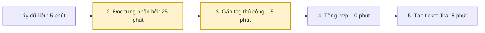
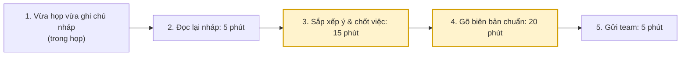
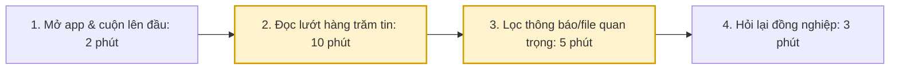

# Báo cáo cá nhân — MSSV_HoTen

> Đổi tên file theo quy tắc `MSSV_HoTen.md`, ví dụ `20241234_NguyenVanAn.md` (MSSV trước, dấu `_`, họ tên viết liền không dấu). Sửa cả dòng tiêu đề phía trên cho khớp.
> Template chi tiết và prompt mẫu cho từng mục: [docs/01-worksheet.md](../../docs/01-worksheet.md).
> Mỗi thành viên một file trong `report/individual/` trên repo nhóm: copy template này thành file mới, điền, rồi commit bằng tài khoản GitHub của bạn. Không viết hộ người khác.

## 1. Thông tin học viên

- Họ tên: Phạm Hồng Khánh Huy
- MSSV: 2A202603588
- Email trường (không bắt buộc, repo có thể để public):
- Tên nhóm: XYZ
- Link repo nhóm: https://github.com/Do-Duan/K5-L3A-Day02-XYZ-DiscoveryProblemFraming.git

---

## 2. Scan problem (CP1)

Lăng kính: **Lặp lại** · **Tốn thời gian** · **Cần đọc, tổng hợp nhiều thông tin** · **Pain từ người khác**.

| # | Lăng kính | Job Story: Khi… tôi muốn… để… | Ai chịu ảnh hưởng? | Dấu hiệu thật (thời gian, tần suất, số người, bằng chứng) |
| --- | --- | --- | --- | --- |
| 1 | Lặp lại | Khi đến cuối tháng nhận lương, tôi muốn đối chiếu các khoản đã chi tiêu từ nhiều nguồn (tiền mặt, thẻ, ví điện tử), để biết chính xác mình đang thâm hụt ở khoản nào và lên ngân sách tháng sau. | Bản thân người quản lý tài chính | Tốn 1-2 tiếng cuối tháng; lặp lại hàng tháng; hay có các khoản chi nhỏ lẻ không có hóa đơn/log ghi nhận lại. |
| 2 | Cần đọc, tổng hợp | Khi mở ứng dụng chat công việc sau 1 ngày nghỉ phép, tôi muốn nắm bắt ngay các quyết định hoặc sự cố đã giải quyết, để bắt nhịp lại luồng công việc mà không cần cuộn đọc từng tin một. | Nhân viên nghỉ phép quay lại làm, đồng nghiệp cùng ca trực / team | Group có 200-300 tin nhắn chưa đọc; tốn 15-20 phút lướt màn hình; rủi ro trôi mất file hoặc thông báo quan trọng. |
| 3 | Lặp lại | Khi bắt đầu sprint mới, tôi muốn chuyển các đầu việc còn tồn đọng từ sprint cũ sang backlog hoặc sprint kế tiếp, để bảng task luôn phản ánh đúng tiến độ hiện tại mà không phải kéo thả từng ticket thủ công. | Team Tech, Scrum Master | Tốn 20–30 phút vào mỗi buổi sáng thứ Hai đầu sprint (2 tuần/lần); lịch sử board Jira/Trello ghi nhận hàng chục ticket bị dồn ứ. |
| 4 | Lặp lại | Khi kết thúc các buổi họp giao ban hàng tuần, tôi muốn ghi nhận nhanh các quyết định và action items, để phân công công việc kịp thời mà không bị sót ý hay hiểu lầm. | Người ghi chép (PM / thư ký / lead), các thành viên tham gia họp | Mất 30–45 phút gõ lại biên bản; lặp lại 1–2 lần/tuần; thường có tin nhắn hỏi lại trong group "việc này deadline bao giờ". |
| 5 | Cần đọc, tổng hợp | Khi tiếp nhận phản hồi từ khách hàng qua form khảo sát hoặc ticket khiếu nại, tôi muốn phân loại các nhóm lỗi phổ biến nhất trong tuần, để chuyển đúng cho đội kỹ thuật xử lý kịp thời. | Customer Support, Product Team | Mất 45–60 phút mỗi ngày để đọc lướt và gắn tag cho 50–70 phản hồi; backlog hỗ trợ thường xuyên bị trễ SLA. |

**Nếu có dùng AI để gợi ý thêm:** ý nào AI gợi ý mà bạn giữ lại, ý nào bỏ và vì sao.

-

---

## 3. Top 3 Problem Cards + quy trình nháp (CP2)

### Bảng chọn top 3

| Rank | Problem | Vì sao chọn | Điều còn chưa chắc |
|---:|---|---|---|
| 1 | Phân nhóm lỗi sản phẩm từ phản hồi khách hàng | Tần suất cao (hằng ngày), impact rõ ràng đến SLA, điểm nghẽn dễ đo lường (đọc & phân loại). | Các phản hồi thô có đủ thông tin để phân loại chính xác, hay toàn phàn nàn chung chung không rõ bối cảnh? |
| 2 | Ghi chép biên bản họp nhóm (Meeting Minutes) | Xảy ra ở mọi team, quy trình chuẩn dễ áp dụng, tiết kiệm thời gian rõ ràng. | AI có nắm bắt đúng ngữ cảnh kỹ thuật/từ viết tắt đặc thù của nội bộ công ty không? |
| 3 | Theo kịp tiến độ group chat sau thời gian nghỉ | Nỗi đau rất thực tế, tác động lớn đến cá nhân và luồng công việc chung. | Rủi ro quyền truy cập dữ liệu bảo mật, giới hạn scope khó (làm sao biết kênh chat nào quan trọng để đọc). |

### Problem Card #1

| Trường | Nội dung |
|---|---|
| Job Story | Khi tiếp nhận phản hồi từ khách hàng qua form khảo sát hoặc ticket khiếu nại, tôi muốn phân loại các nhóm lỗi phổ biến nhất trong tuần, để chuyển đúng cho đội kỹ thuật xử lý kịp thời. |
| Actor | Nhân viên Customer Support (CS) / Product Team. |
| Thời điểm / bối cảnh | Cuối ngày làm việc, khi cần rà soát và chuyển tiếp 50-70 phản hồi tồn đọng trên hệ thống hỗ trợ. |
| Quy trình hiện tại (3–7 bước) | 1. Trích xuất dữ liệu feedback từ hệ thống · 2. Đọc từng phản hồi thô · 3. Gắn tag phân loại thủ công (Lỗi UI, Lỗi thanh toán...) · 4. Tổng hợp danh sách theo nhóm lỗi · 5. Tạo ticket Jira và assign cho Dev. |
| Bottleneck (bước nào, mất bao nhiêu phút) | Bước 2 và 3 (Đọc và gắn tag thủ công): tốn khoảng 40 phút/ngày, lặp đi lặp lại, dễ bị thiên kiến hoặc sai sót. |
| Impact (nếu không giải thì sao) | Tốn 45-60 phút/ngày/nhân viên CS; Backlog thường xuyên trễ SLA 24h; Dev chậm fix bug do mô tả lỗi không được gom nhóm hệ thống. |
| Success metric (baseline → target) | Giảm tổng thời gian xử lý từ 60 phút xuống dưới 15 phút/ngày; Tỷ lệ phải gắn tag lại (re-tag) dưới 10%; Không còn ticket nào trễ SLA phân luồng. |
| Phương án không dùng AI | Dùng form ép khách hàng tự chọn loại lỗi từ Dropdown. (Nhược điểm: Khách hàng thường lười nên hay chọn bừa hoặc chọn "Khác", CS vẫn phải đọc lại toàn bộ). |
| Giả thuyết về AI (nếu có) | Hệ thống rule kéo dữ liệu → AI đọc, tự động đề xuất tag phân loại và tóm tắt lỗi → CS review/chốt tag → Đẩy sang Jira. |
| Cảm nhận nhanh | Workflow |

Quy trình nháp hiện tại:

### Problem Card #2

| Trường | Nội dung |
|---|---|
| Job Story | Khi kết thúc các buổi họp giao ban hàng tuần, tôi muốn ghi nhận nhanh các quyết định và action items, để phân công công việc kịp thời mà không bị sót ý hay hiểu lầm. |
| Actor | Người ghi chép (PM / thư ký / lead) |
| Thời điểm / bối cảnh | Trong và ngay sau cuộc họp giao ban kéo dài 1-2 tiếng. |
| Quy trình hiện tại (3–7 bước) | 1. Vừa họp vừa gõ ghi chú nháp · 2. Họp xong đọc lại bản nháp · 3. Sắp xếp lại ý, chốt quyết định & action items · 4. Gõ lại thành biên bản chuẩn · 5. Gửi email / Slack cho team. |
| Bottleneck (bước nào, mất bao nhiêu phút) | Bước 1 (vừa họp vừa ghi dễ sót ý, mất tập trung) và Bước 3, 4 (sắp xếp và gõ lại mất 30-45 phút). |
| Impact (nếu không giải thì sao) | Mất 30-45 phút gõ lại biên bản sau họp; lặp lại 1-2 lần/tuần; người ghi chép không thể tập trung đóng góp ý kiến; dễ sót việc. |
| Success metric (baseline → target) | Thời gian làm meeting minutes giảm từ 45 phút xuống dưới 10 phút/buổi. Tỷ lệ sót action item = 0. |
| Phương án không dùng AI | Dùng template cố định, phân công 1 người luân phiên chỉ chuyên ghi chép (không tham gia ý kiến) hoặc thu âm nghe lại (nhưng nghe lại tốn gấp đôi thời gian). |
| Giả thuyết về AI (nếu có) | Record âm thanh → AI speech-to-text và tóm tắt theo cấu trúc (Quyết định, Action items) → Người phụ trách review, chỉnh sửa → Gửi. |
| Cảm nhận nhanh | Workflow |

Quy trình nháp hiện tại:

### Problem Card #3

| Trường | Nội dung |
|---|---|
| Job Story | Khi mở ứng dụng chat công việc sau 1 ngày nghỉ phép, tôi muốn nắm bắt ngay các quyết định hoặc sự cố đã giải quyết, để bắt nhịp lại luồng công việc mà không cần cuộn đọc từng tin một. |
| Actor | Nhân viên nghỉ phép quay lại làm (hoặc đồng nghiệp cùng ca). |
| Thời điểm / bối cảnh | Đầu giờ sáng ngày đi làm lại, khi mở ứng dụng chat (Slack/Zalo/Teams) lên. |
| Quy trình hiện tại (3–7 bước) | 1. Mở app chat và cuộn lên tin nhắn chưa đọc đầu tiên · 2. Đọc lướt hàng trăm tin nhắn · 3. Lọc ra các file, thông báo, nhắc tên quan trọng · 4. Nhắn tin hỏi lại đồng nghiệp để làm rõ bối cảnh. |
| Bottleneck (bước nào, mất bao nhiêu phút) | Bước 2 và 3 (Đọc lướt và lọc thông tin): tốn 15-20 phút, nhiễu loạn thông tin. |
| Impact (nếu không giải thì sao) | Mất 15-20 phút lãng phí mỗi lần nghỉ; rủi ro trôi mất thông tin, file quan trọng; làm phiền đồng nghiệp khi phải hỏi lại. |
| Success metric (baseline → target) | Thời gian nắm bắt luồng công việc giảm từ 20 phút xuống dưới 2 phút. Không bỏ sót bất kỳ quyết định/file quan trọng nào. |
| Phương án không dùng AI | Yêu cầu mọi quyết định đều phải cập nhật lên Trello/Wiki thay vì chỉ chat (khó duy trì kỷ luật nhóm) hoặc nhờ đồng nghiệp tóm tắt miệng. |
| Giả thuyết về AI (nếu có) | Chọn mốc thời gian vắng mặt → AI đọc log chat → AI tạo bản tóm tắt phân mục (Quyết định, File, Sự cố) → Người dùng đọc tóm tắt. |
| Cảm nhận nhanh | Workflow hoặc Agent |

Quy trình nháp hiện tại:

### Card muốn pitch nhất

- Card số: 1 (Phân nhóm lỗi sản phẩm từ phản hồi khách hàng)
- Vì sao: Có impact rộng, lặp lại hàng ngày (chứ không thỉnh thoảng như nghỉ phép), có baseline thời gian đo lường cực rõ, và kiến trúc Workflow can thiệp rất dễ thực thi trong giới hạn của lab.
- Câu hỏi muốn nhóm phản biện: Dữ liệu phản hồi thô của khách hàng có đủ ngữ cảnh để AI phân loại chính xác không, hay cần cung cấp thêm log hành vi hệ thống cho AI?

### AI đã phản biện card thế nào

| Điểm yếu AI chỉ ra | Đồng ý? | Đã sửa gì |
|---|---|---|
| AI có thể phân loại sai nếu khách hàng dùng ngôn ngữ mạng (teencode), viết sai chính tả, hoặc phàn nàn mập mờ. | Đồng ý | Thêm bước "CS review và chốt tag trước khi đẩy sang Jira" để làm ranh giới (Boundary) - con người luôn kiểm soát đầu ra cuối cùng. |
| Khách hàng có thể phàn nàn 3-4 lỗi khác nhau trong cùng 1 feedback dài, nếu AI chỉ gắn 1 tag (single-label) sẽ gây sót lỗi. | Đồng ý | Chuyển yêu cầu từ "Gắn 1 tag phân loại" thành "Trích xuất danh sách các lỗi và gắn multi-tag (nhiều thẻ)". Đưa vào giả định cần kiểm chứng ở CP4. |
| Đề xuất tự động tạo ticket Jira và assign luôn cho Dev mà không cần CS can thiệp để tối ưu tốc độ. | Không đồng ý | Giữ nguyên bước CS duyệt. Tránh rủi ro AI tạo hàng loạt ticket rác (spam Jira) gây phiền hà cho đội ngũ kỹ thuật. |

---

## 4. Tôi đã tham gia phần nào (CP3 → CP7)

| Hoạt động | Tôi đã làm gì? | Kết quả / ảnh hưởng tới bài nhóm |
|---|---|---|
| Pitch Problem Card | Pitch candidate #1: "Phân nhóm lỗi sản phẩm từ phản hồi khách hàng" | Bài toán có impact cao và dễ chứng minh mức độ can thiệp AI, được nhóm thống nhất chọn làm Problem Statement cuối cùng. |
| Phản biện bài của bạn khác | Câu hỏi tôi đã đặt: "Bài toán 'Nhập hồ sơ học viên' (#10 của Dũng) vướng rào cản nhận giấy tờ cứng. Nếu thời gian chờ giấy tờ lâu hơn thời gian nhập liệu thì AI có giải quyết được cốt lõi không?" | Nhóm nhận ra đây là rào cản thao tác vật lý, cần giải pháp No AI (chuẩn hóa luồng bằng Google Form) thay vì dùng AI. |
| Nhận phản biện | Câu hỏi tôi nhận được: "Dữ liệu phản hồi thô của khách hàng có đủ ngữ cảnh để AI phân loại chính xác không, hay cần log hệ thống?" (Đức hỏi) | Tôi đã sửa gì: Thêm bước Human-in-the-loop (CS review và chốt tag) vào ranh giới (Boundary) để con người luôn kiểm soát đầu ra cuối cùng trước khi đẩy lên Jira. |
| Gom cluster / cây OST | Gom nhóm 12 candidate thành 4 Cluster chính (A, B, C, D) dựa trên pattern hành vi. | Giúp nhóm vẽ Opportunity Solution Tree rõ ràng, tập trung vào Outcome "Giảm thời gian xử lý dữ liệu thô". |
| Chọn candidate problem | Xây dựng tiêu chí và tham gia chấm điểm shortlist (1-5) cho top 5 candidates. | Chọn được candidate #1 đạt 33/40 điểm, khả thi nhất để triển khai lab Workflow. |
| Kiểm chứng / research | Phỏng vấn chéo 2 sinh viên từng trực page/quản lý sự kiện; Khảo sát 3 giải pháp: Bộ lọc Sheets (No AI), GPT for Sheets (Workflow), Zendesk (Agent). | Xác nhận pain-point là có thật; quyết định không dùng AI trả lời khách tự động mà chỉ làm chức năng Drafting/Tagging (gắn nhãn). |
| Quy trình nhóm | Vẽ quy trình hiện tại (60 phút) và quy trình tương lai (15 phút) cho bài toán phân loại feedback. | Làm rõ Bottleneck nằm ở bước "Đọc phản hồi" và "Gắn tag". Xác định rõ điểm AI can thiệp. |
| Problem Statement | Định nghĩa rõ v0 và v1: Actor, Bottleneck, Impact, Success Metric, Boundary. | Thống nhất được bộ 4 tiêu chí đánh giá (Eval) cho bản nháp tag của AI (Đúng danh mục, Không sót lỗi, Không bịa, Trích xuất đúng lý do). |
| Mức can thiệp AI | Phân tích ma trận độ mơ hồ × độ phức tạp; lập luận loại trừ các mức No AI, Rule, Agent. | Chốt mức can thiệp **Workflow** (AI đọc form $\rightarrow$ gán nhãn nháp $\rightarrow$ CS duyệt $\rightarrow$ gửi Jira). |
| Quyết định | Phân tích 4 rủi ro sản phẩm (Value, Usability, Feasibility, Viability). | Chốt quyết định **Go**, thiết kế pilot nhỏ trong 2 tuần bằng Google Sheets tích hợp script gọn nhẹ, có ngưỡng dừng rõ ràng. |

---

## 5. Dùng AI

| Checkpoint | Tôi dùng AI để làm gì? | AI hữu ích ở đâu? | AI sai hoặc hời hợt ở đâu? | Tôi sửa gì bằng nhận định của mình? |
|---|---|---|---|---|
| CP1 Scan | Gợi ý mở rộng các problem trong mảng quản trị sản phẩm và CSKH. | Giúp tìm ra các keyword chuẩn như "SLA", "Spillover sprint", "Meeting minutes". | AI hay đưa ra các problem quá vĩ mô (vd: "Quản lý toàn bộ dự án bằng AI") không có quy trình cụ thể. | Tôi loại bỏ các ý vĩ mô, chỉ giữ lại các problem có tần suất lặp lại hàng tuần/hàng ngày và đo lường được bằng phút. |
| CP2 Problem Card | Đóng vai trò phản biện (Devil's Advocate) để tìm lỗ hổng trong quy trình nháp. | Chỉ ra rủi ro AI có thể không hiểu được ngôn ngữ mạng (teencode) của khách hàng. | Đề xuất giải pháp Agent "Tự động assign ticket cho Dev không cần duyệt" để tối ưu thời gian tuyệt đối. | Bác bỏ đề xuất Agent. Tôi giữ nguyên bước CS duyệt để tránh làm "rác" hệ thống Jira của Dev (Boundary cứng). |
| CP4 Research | Tìm kiếm các giải pháp tự động hóa phân loại khiếu nại hiện có trên thị trường. | Tìm ra "GPT for Sheets" và "Zendesk" làm tham chiếu rất tốt. | Phân tích tính khả thi khá hời hợt, cho rằng chỉ cần prompt zero-shot là xong. | Tôi bổ sung nhận định: Cần thiết kế prompt có cấu trúc (Few-shot, ép JSON) thay vì zero-shot để đảm bảo tỷ lệ đúng nhãn > 95%. |
| CP5 Quy trình | Chuyển đổi mô tả luồng công việc text sang format mã Mermaid để vẽ sơ đồ. | Tạo sơ đồ nhanh, chuẩn cú pháp Mermaid, hiển thị rõ bước bottleneck. | Đôi khi gộp các bước quan trọng (VD: gộp "Đọc" và "Gắn tag" làm một). | Tôi chủ động tách nhỏ lại thành các bước độc lập để đánh giá đúng thời gian từng khâu. |
| CP5–6 Problem Statement | Hỗ trợ tinh chỉnh wording cho 4 tiêu chí đánh giá bản nháp của AI. | Làm cho câu từ chuyên nghiệp, dễ hiểu. | Metric đưa ra thường chỉ tập trung vào tốc độ xử lý. | Bổ sung thêm metric về chất lượng (Tỷ lệ phải re-tag dưới 10%). |
| CP6 Mức can thiệp / quyết định | Viết nháp cấu trúc đánh giá 4 loại rủi ro (Value, Usability, Feasibility, Viability). | Cung cấp template phân tích nhanh chóng. | Rủi ro Viability (chi phí, pháp lý) bị đánh giá chung chung, không sát với bối cảnh bài lab. | Tự viết lại phần Viability, nhấn mạnh vào giới hạn chi phí token và chính sách dữ liệu nội bộ của doanh nghiệp. |

---

## 6. Reflection (CP7)

**6.1. Tôi học được gì khi nghe top 3 problems của các bạn khác?**
Qua các bài toán của Đức (đối soát settlement cổng thanh toán) và Duẩn (kiểm tra sổ tay 100+ trang), tôi nhận ra không phải bài toán nào phức tạp, tốn nhiều thời gian cũng cần đến AI tạo sinh (GenAI). Kế toán tài chính đòi hỏi tính chính xác tuyệt đối 100%. Những vấn đề này thực chất là hậu quả của quy trình lỏng lẻo. Cách giải quyết tốt nhất là chuẩn hóa dữ liệu từ đầu (No AI) hoặc viết script so khớp mã (Rule), thay vì dùng LLM rất dễ sinh ảo giác (hallucination) làm sai số liệu.

**6.2. Nhóm có lúc nào bị "solution-first" (nghĩ giải pháp trước khi hiểu vấn đề) không? Lúc đó nhóm nhận ra và xử lý thế nào?**
Có. Trong quá trình lập cây Opportunity Solution Tree, nhóm tôi từng vô thức đưa ý kiến "Cần hệ thống tự động trích xuất hóa đơn" vào làm nhánh nhu cầu. Sau khi đọc lại lý thuyết, chúng tôi nhận ra "hệ thống tự động" là giải pháp. Nhu cầu thực sự bên dưới nỗi đau đó là: "Phải gõ tay lại từng bản ghi thô tốn thời gian". Chúng tôi đã xóa câu đó đi và phát biểu lại thành nhánh nhu cầu chuẩn xác, tập trung vào sự mệt mỏi khi phải nhập liệu thủ công.

**6.3. Tôi có đổi ý sau khi bị phản biện không? Kể một lần cụ thể.**
Có. Ban đầu tôi thiết kế quy trình là AI đọc feedback khách hàng và chỉ gắn duy nhất 1 tag (single-label) cho mỗi phản hồi để đơn giản hóa. Tuy nhiên, Đức đã phản biện rằng một khách hàng khi bực tức thường phàn nàn 3-4 lỗi cùng lúc trong một đoạn text dài. Nhận ra điều này rất thực tế, tôi đã đổi ý, chỉnh lại yêu cầu output của AI thành gán nhiều thẻ (multi-label) và phải trích xuất luôn lý do (3-4 chữ) tương ứng với từng thẻ để Customer Support dễ dàng review lướt qua.

**6.4. Kết quả kiểm chứng (phỏng vấn/survey/research) có làm tôi bất ngờ không? Điều gì?**
Điều làm tôi bất ngờ nhất khi phỏng vấn chéo các bạn từng làm trực page là họ không hề muốn AI tự động trả lời khách hàng (mặc dù đó là thứ mọi người hay nghĩ đến nhất khi nói về bot AI). Nỗi sợ lớn nhất của họ là AI trả lời sai ngữ cảnh, gây khủng hoảng truyền thông. Thứ họ thực sự cần chỉ là một trợ lý ngầm, gán sẵn tag phân loại trên bảng tính nội bộ để họ báo cáo cho sếp. Điều này khẳng định triết lý "Augment > Automate" (Hỗ trợ tốt hơn là Tự động hóa hoàn toàn) trong thiết kế sản phẩm AI.

**6.5. Điều khó nhất khi viết Problem Statement là gì?**
Điều khó nhất là thiết lập Metric đánh giá (Tiêu chí thành công) cho phần chất lượng của AI. Đo tốc độ rất dễ (giảm từ 60 phút xuống 15 phút), nhưng đo độ chính xác của một văn bản tự do do AI sinh ra thì rất khó. Nhóm phải mất khá nhiều thời gian thảo luận để quy chuẩn hóa các tiêu chí, ví dụ "không được tự bịa ra lỗi nếu không có trong đoạn chat gốc", và xác định rõ ngưỡng dừng (pilot thất bại nếu phải sửa tay lại trên 50% số nhãn).

**6.6. Nếu làm lại, tôi sẽ đổi gì? Tôi sẽ phản biện nhóm mạnh hơn ở điểm nào?**
Nếu làm lại, tôi sẽ nhấn mạnh vào việc kiểm chứng giả định "Viability" (Tính khả thi về mặt quy định, pháp lý) sớm hơn. Ban đầu nhóm quá say mê với việc phân loại text mà quên mất rằng, phản hồi của khách hàng có thể chứa thông tin cá nhân nhạy cảm (PII như tên, số điện thoại). Tôi sẽ yêu cầu nhóm bổ sung ngay một bước "ẩn danh dữ liệu" trước khi đẩy nguyên đoạn chat đó qua API của ChatGPT/Claude để đảm bảo an toàn thông tin nội bộ.

---

## 7. Tài liệu tham khảo

- Hướng dẫn Lab Day 02: Discovery & Problem Framing (K5 - Level 3 Practical AI).
- Framework 4 Big Risks (Value, Usability, Feasibility, Viability) — Marty Cagan (*Inspired*).
- Cẩm nang thiết kế trải nghiệm AI (People + AI Guidebook / PAIR) — Google.
- Phương pháp phỏng vấn tìm kiếm nhu cầu thật (The Mom Test) — Rob Fitzpatrick.
- Mô hình Double Diamond (Discover - Define) — Design Council (UK).